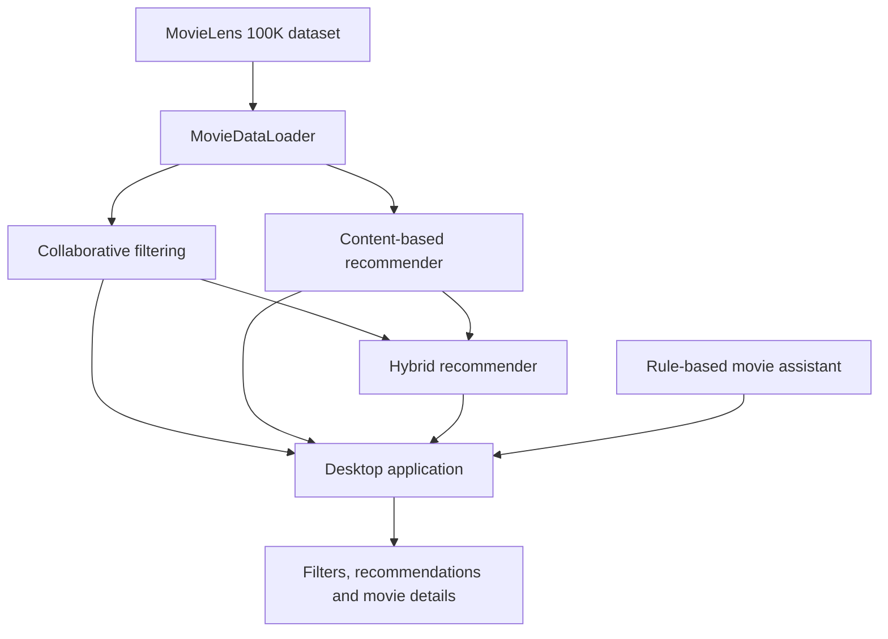

# 🎬 Movie Recommender

<div align="center">

**A Python desktop application for movie discovery and personalized recommendations.**

[](https://www.python.org/)
[](https://github.com/TomSchimansky/CustomTkinter)
[](https://scikit-learn.org/)
[](LICENSE)

</div>

---

## Overview

Movie Recommender is a desktop application that explores three recommendation approaches—collaborative filtering, content-based filtering, and a hybrid model—using the MovieLens 100K dataset. It also includes a rule-based movie assistant for conversational discovery and entertainment features.

The project is intended as a practical learning project for recommender systems, Python application development, and applied machine learning.

## Features

### Recommendation engine

- **Collaborative filtering:** SVD, KNNBaseline, and NMF models through [Surprise](https://surpriselib.com/).
- **Content-based recommendations:** movie-genre features, TF-IDF representations, and cosine similarity.
- **Hybrid recommendations:** combines collaborative and content-based scores with a configurable weighting factor.
- **Model evaluation:** evaluates collaborative models with RMSE and identifies the lowest-RMSE model.
- **Movie filters:** filter recommendations by genre, release year, minimum rating, and result count.

### Movie assistant

The application includes a rule-based assistant with features such as:

- Mood-aware genre suggestions.
- Movie information and recommendation queries.
- Movie comparisons and follow-up prompts.
- Trivia, quizzes, guessing games, and weekly suggestions.
- Local conversation-history and preference handling.

> **AI/API clarification:** The assistant is rule-based; it is not currently backed by an LLM. Optional TMDB, OMDb, and YouTube API helper methods contain placeholder API keys and require secure configuration before use. Do not commit real API keys.

## Technology

| Area | Tools |
|---|---|
| Desktop UI | CustomTkinter, Tkinter |
| Language | Python |
| Recommendation algorithms | Surprise (SVD, KNNBaseline, NMF) |
| Content similarity | scikit-learn, TF-IDF, cosine similarity |
| Data processing | Pandas, NumPy |
| Visualization | Matplotlib, Seaborn |
| HTTP integrations | Requests |
| Tests | pytest |

## How it works



## Getting started

### Requirements

- Python 3.10 or a compatible Python environment.
- pip.
- The MovieLens 100K files included in `data/ml-100k/`.

### 1. Clone the repository

```bash
git clone https://github.com/kiannaseri/Movie_recommender.git
cd Movie_recommender
```

### 2. Create and activate a virtual environment

**Windows (PowerShell):**

```powershell
python -m venv .venv
.venv\Scripts\Activate.ps1
```

**macOS / Linux:**

```bash
python3 -m venv .venv
source .venv/bin/activate
```

### 3. Install dependencies

```bash
python -m pip install --upgrade pip
python -m pip install -r requirements.txt
```

### 4. Run the application

```bash
python main.py
```

The application loads the included MovieLens 100K dataset on startup. Once loading finishes, select **Train Models** before requesting collaborative or hybrid recommendations.

## Run tests

Install the development dependencies and run the focused unit tests:

```bash
python -m pip install -r requirements-dev.txt
python -m pytest -q
```

The current test suite covers recommender model selection and hybrid-weight boundary handling.

## Repository structure

```text
Movie_recommender/
├── main.py
├── chatbot.py
├── chatbot_advanced.py
├── requirements.txt
├── requirements-dev.txt
├── src/
│   ├── collaborative.py
│   ├── content_based.py
│   ├── data_loader.py
│   ├── hybrid.py
│   └── utils.py
├── tests/
│   └── test_model_selection.py
└── data/
    └── ml-100k/
```

## Dataset

This project uses the [MovieLens 100K dataset](https://grouplens.org/datasets/movielens/100k/). The dataset files required by the current application are already included under `data/ml-100k/`; no separate download step is required.

Please review the dataset provider's terms and attribution requirements when redistributing the dataset.

## Current limitations

- The chatbot uses rule-based logic rather than a generative AI model.
- Optional third-party API integrations are not ready to use until valid credentials are configured securely.
- The current automated tests cover selected recommendation helpers, not the full desktop UI or every model-training path.
- The project is a learning/prototype application and has not been presented as a production service.

## Contributing

Issues and pull requests are welcome. For bug reports, include your Python version, operating system, steps to reproduce, and relevant error output. Never include API keys or personal data in an issue.

## License

This project is distributed under the MIT License. See [LICENSE](LICENSE).

---

<div align="center">

**Built by [Kian Naseri](https://github.com/kiannaseri)**

</div>
